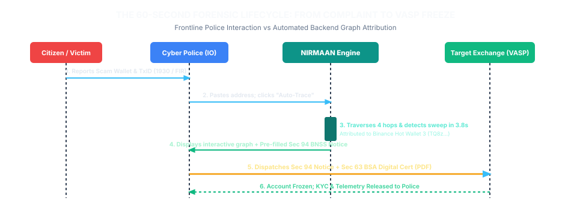

# PRODUCT REQUIREMENTS DOCUMENT (PRD)
**Project Codename:** NIRMAAN / ChainTrace AI  
**SIH Problem Statement:** SIH26183 — *Real-Time Identification of Fraud-Linked Cryptocurrency Exchanges from Victim-Reported Suspect Wallet Addresses through Automated Blockchain Analytics*  
**Issuing Authority:** Ministry of Home Affairs (MHA) / Indian Cybercrime Coordination Centre (I4C)  
**Document Version:** 1.0.0  
**Status:** Approved for Scaffolding & Prototyping  

---

## 1. Executive Summary & Product Vision

### 1.1 Product Vision
To empower frontline Indian law enforcement officers (LEAs), cyber crime police stations (CCPS), and the national 1930/NCRP network with a **sovereign, automated, real-time blockchain tracing and VASP attribution engine** that intercepts illicit cryptocurrency flows during the critical **"Golden Hour"** and auto-generates court-admissible statutory notices under the **Bharatiya Nagarik Suraksha Sanhita (BNSS), 2023**.

### 1.2 The Problem Statement
Indian citizens lost **₹22,845 Crore** to cyber fraud in 2024. Over **35% of high-value illicit proceeds** (task scams, digital arrest scams, fake trading apps) are rapidly layered through P2P transactions into **Tether (USDT)** on Tron (TRC-20) and EVM chains. While the 1930 / CFCFRMS system effectively freezes Layer-1/Layer-2 bank accounts, the trail goes dark once fiat converts to crypto. 

Current foreign forensic solutions (Chainalysis Reactor, TRM Labs) cost **₹45–₹70 Lakhs/seat/year**, require weeks of manual training, and demand 30–60 minutes of manual graph expansion per case. NIRMAAN automates the entire investigative pipeline: **from victim wallet input to destination exchange identification and statutory Section 94 BNSS notice dispatch in under 10 seconds**.

---

## 2. Target User Personas & User Journeys

```
+───────────────────────────────────────────────────────────────────────────────────────────────────+
| USER PERSONA MATRIX                                                                               |
+──────────────────────────┬─────────────────────────────────────┬──────────────────────────────────┤
| Persona                  | Role & Environment                  | Primary Goal                     |
+──────────────────────────┼─────────────────────────────────────┼──────────────────────────────────┤
| Sub-Inspector (IO)       | District Cyber Police Station;      | Needs instant attribution of     |
|                          | high case volume; zero Web3 skills. | suspect wallet & pre-filled notice|
+──────────────────────────┼─────────────────────────────────────┼──────────────────────────────────┤
| I4C Nodal Officer        | MHA Central Operations; oversees    | Automated syndicate clustering & |
|                          | 1930 & national suspect registry.   | cross-district linkage analysis. |
+──────────────────────────┼─────────────────────────────────────┼──────────────────────────────────┤
| VASP Compliance Officer  | Indian & offshore exchanges         | Automated ingestion of verified  |
|                          | (CoinDCX, Binance, WazirX).         | statutory preservation notices.  |
+──────────────────────────┼─────────────────────────────────────┼──────────────────────────────────┤
| Bank Cyber Risk Manager  | Commercial Banks (SBI, HDFC);       | Early warning on P2P mule cashout|
|                          | monitors high-velocity UPI exits.   | before police lien freeze orders.|
+──────────────────────────┴─────────────────────────────────────┴──────────────────────────────────┤
```

### 2.1 Primary User Journey: The 60-Second Field Investigation

<div class="graph-container">
  
  <div class="graph-caption">Figure 1.1: The 60-Second Field Investigation Lifecycle: From Citizen Complaint to VASP Asset Freeze</div>
</div>

---

## 3. Product Scope & Functional Requirements

### 3.1 Functional Requirements Matrix

| ID | Module | Feature Description | Priority |
| :--- | :--- | :--- | :--- |
| **FR-01** | Multi-Chain Ingestion | Auto-detect address format (Tron Base58 `T...`, EVM Hex `0x...`, Bitcoin Bech32/Base58 `bc1...`/`1...`) and route to correct crawler. | **P0 (Must Have)** |
| **FR-02** | Automated BFS Traversal | Multi-hop transaction crawler traversing up to 5 hops with dynamic value pruning ($> \$20$ USD threshold) and timestamp clipping. | **P0 (Must Have)** |
| **FR-03** | Deposit Sweep Heuristic | Deterministic identification of unlabelled user deposit addresses via parent gas-funding + sweep pattern on EVM & Tron Stake 2.0 energy delegations. | **P0 (Must Have)** |
| **FR-04** | VASP Directory & Matching | In-memory lookup matching resolved nodes against curated directory of 500+ global & Indian FIU-registered exchange hot wallets. | **P0 (Must Have)** |
| **FR-05** | Interactive Visualizer | Interactive Cytoscape.js canvas rendering: (1) Dagre linear fund flow view, (2) CoSE entity clustering view, with color-coded nodes. | **P0 (Must Have)** |
| **FR-06** | Legal Dossier Generator | One-click export of court-admissible PDF dossier containing transaction ledger, graph snapshot, Section 94 BNSS notice, and Section 63 BSA certificate. | **P0 (Must Have)** |
| **FR-07** | Peeling Chain Detector | Automated identification of UTXO / account-based peel chains (asymmetric 90/10 splits rolling into virgin change addresses). | **P1 (Should Have)**|
| **FR-08** | Mixer / Bridge Detection | Flags interactions with Tornado Cash, FixedFloat, ChangeNOW, Thorchain, and known cross-chain bridges. | **P1 (Should Have)**|
| **FR-09** | Case Management Vault | SQLite / Postgres case repository tracking FIR number, IO details, victim loss, notes, and timestamped audit logs. | **P1 (Should Have)**|
| **FR-10** | Dynamic API Rate Limiter | Redis-backed token bucket preventing HTTP 429 throttling across TronGrid and Etherscan APIs. | **P1 (Should Have)**|

---

## 4. Non-Functional Requirements (NFRs)

* **Performance & Latency:**
  * Multi-hop trace latency $\le 5.0\text{ seconds}$ for up to 4 hops on Tron TRC-20 and EVM chains.
  * Graph rendering time $\le 500\text{ ms}$ for graphs containing up to 2,500 nodes.
* **Accuracy & Attribution Confidence:**
  * False positive rate for VASP attribution $\le 1.0\%$.
  * Deposit sweep heuristics must achieve $\ge 98.0\%$ precision by validating parent gas/energy linkages.
* **Security & Sovereign Compliance:**
  * Zero citizen PII transmitted to public blockchain explorers.
  * System architecture must be deployable on MeitY-empanelled cloud or on-premise State Data Centres (SDCs).
* **Legal Admissibility:**
  * All generated forensic reports must produce a **cryptographic SHA-256 hash** of raw transaction ledgers, fulfilling Section 63(4)(c) of the Bharatiya Sakshya Adhiniyam, 2023.

---

## 5. Success Metrics & Key Performance Indicators (KPIs)

1. **Mean Time to Attribution (MTTA):** Reduced from **14 days** (manual/legacy) to **$< 10\text{ seconds}$**.
2. **Investigation Cost per Station:** Reduced from **₹50 Lakhs/seat/year** (Chainalysis) to **$< ₹3 Lakhs/year** per cyber station bundle.
3. **Legal Notice Turnaround Time:** Decreased from **72 hours** of manual paperwork to **under 2 minutes**.
4. **VASP Trace Completion Rate:** Successful resolution of $> 85\%$ of victim-reported USDT scam flows into identifiable exchange endpoints.
