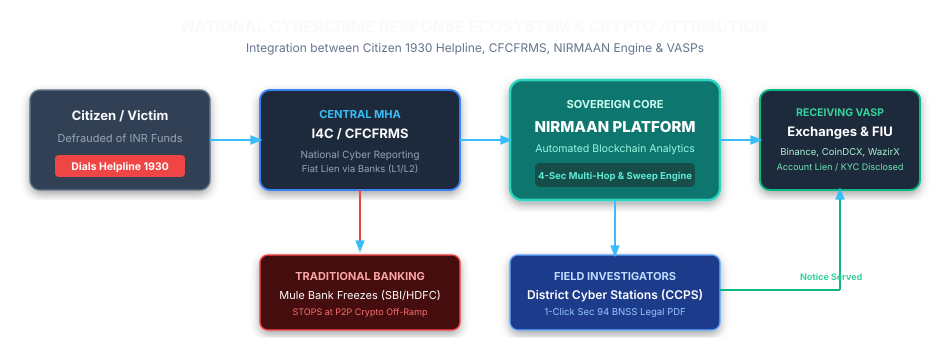

# COMPREHENSIVE RESEARCH DOSSIER
**Project Codename:** NIRMAAN / ChainTrace AI  
**SIH Problem Statement:** SIH26183 — *Real-Time Identification of Fraud-Linked Cryptocurrency Exchanges from Victim-Reported Suspect Wallet Addresses through Automated Blockchain Analytics*  
**Issuing Authority:** Ministry of Home Affairs (MHA) / Indian Cybercrime Coordination Centre (I4C)  
**Document Version:** 1.0.0  

---

## 1. Problem Statement Context & The Indian Cybercrime Landscape

<div class="graph-container">
  
  <div class="graph-caption">Figure 3.1: National Cybercrime Response Ecosystem & Automated Crypto Attribution Architecture</div>
</div>


### 1.1 The Operational Gap in the 1930 Helpline & CFCFRMS
The Indian Cybercrime Coordination Centre (I4C), under the Ministry of Home Affairs (MHA), operates the **Citizen Financial Cyber Fraud Reporting and Management System (CFCFRMS)** and the national toll-free helpline **1930**. 
* **The "Golden Hour":** When a victim reports a cyber fraud within 2 hours, the 1930 system dispatches automated API freeze requests down traditional banking channels (Layer 1, Layer 2, Layer 3 mule bank accounts).
* **The Crypto Black Hole:** Cybercrime syndicates (specifically Southeast Asian syndicates in Cambodia, Myanmar, and Laos operating "pig butchering", task fraud, and digital arrest scams) convert stolen INR into cryptocurrency via P2P desks on exchanges within **15 to 30 minutes**. 
* Traditional banking liens hit an empty account; the money has already exited into **Tether (USDT) on TRON (TRC-20) or Binance Smart Chain (BEP-20)**.

### 1.2 Official Fraud Statistics (2024–2025 Benchmarks)
* **National Loss Volume:** Indian citizens lost **₹22,845 Crore** to cyber financial fraud in calendar year 2024.
* **Complaint Volume:** Total complaints registered on the National Cybercrime Reporting Portal (NCRP) crossed **65.89 Lakh cumulative complaints**, with cumulative reported citizen losses exceeding **₹55,050 Crore**.
* **Crypto's Laundering Share:** I4C empirical studies indicate that **over 35% of all high-value cyber fraud proceeds** are laundered via USDT on TRC-20 and EVM chains, representing an estimated **₹7,000 to ₹9,000 Crore of annual illicit crypto outflows from India**.

---

## 2. In-Depth Competitive Intelligence

### 2.1 Competitor Benchmarking Matrix

| Competitor | Valuation | Est. Annual Revenue (ARR) | License Cost / Seat | Target Segment | Key Shortcomings in Indian Context |
| :--- | :--- | :--- | :--- | :--- | :--- |
| **Chainalysis** | $8.6B | ~$175M – $200M+ | **$30,000 – $100,000+ / yr** (~₹45L–₹85L) | Federal LEAs (FBI, IRS-CI), Tier-1 Banks | Prohibitive cost; complex manual UI; zero native integration with I4C / BNSS legal notices. |
| **TRM Labs** | $2.0B | ~$100M | **$35,000 – $80,000 / yr** (~₹30L–₹65L) | US Federal LEAs (ICE, Secret Service), Top VASPs | High-end pricing; indirect exposure scoring creates noise for frontline Indian officers. |
| **Elliptic** | $670M | ~$35M – $65M | **$15,000 – $50,000 / yr** + API consumption | UK/EU Banks, Custodians, Regulators | Focused on Western TradFi compliance; weak dynamic sweep attribution on TRON. |
| **Merkle Science** | $100M–$250M | ~$5M – $12M | **$10,000 – $30,000 / yr** base | Mid-market VASPs, regional cyber units | Slower graph visualization; lacks automated Section 94 notice dispatch workflows. |
| **Bitquery** | ~$50M | ~$3.2M | Developer API ($13/mo – $5k/mo) | Web3 developers, quants | Developer API tool; provides no out-of-the-box investigative GUI or court-ready dossiers. |
| **MistTrack** | Private | Undisclosed | Freemium bot + API credits | Incident response, DeFi security | Hong Kong/APAC focus; no Indian FIU-IND regulatory or statutory notice workflows. |

### 2.2 Empirical Indian Police Procurement Evidence
* **Kerala Police Cyber Operations Tender (`2024_KP_678291_1` / `E1(c)-6143/2024/Cyb(1)`):**
  * Procurement of **01 single-user license** of a cryptocurrency analyzing tool (Chainalysis).
  * Sanctioned budget: **₹50.00 Lakhs ($60,000 USD)**; final award: **₹45.00 Lakhs**.
* **UP ATS & Bihar Police GeM Bids (`GEM/2025/B/6908820`, `GEM/2026/B/8076690`):**
  * Single-station software tenders consistently exhaust ₹40L – ₹1.2 Crore, proving that foreign software is mathematically unaffordable for the 800+ subordinate district-level cyber police stations across India.

---

## 3. Statutory Legal Framework (Active July 1, 2024)

To ensure evidence gathered by NIRMAAN is admissible in Indian courts, the platform natively implements the **new criminal law codes** enacted on July 1, 2024:

```
+───────────────────────────────────────────────────────────────────────────────────────────────────+
| INDIAN STATUTORY TRANSITION MATRIX                                                                |
+──────────────────────────────────┬─────────────────────────────────┬──────────────────────────────┤
| Previous Statutory Code (Old)    | Active Modern Code (BNSS/BSA)   | Operational Legal Scope      |
+──────────────────────────────────┼─────────────────────────────────┼──────────────────────────────┤
| Section 91 CrPC, 1973            | Section 94 BNSS, 2023           | Requisition of documents,    |
|                                  |                                 | electronic logs & KYC.       |
+──────────────────────────────────┼─────────────────────────────────┼──────────────────────────────┤
| Section 102 CrPC, 1973           | Section 106 & 107 BNSS, 2023    | Police order for freezing    |
|                                  |                                 | & attaching crypto assets.   |
+──────────────────────────────────┼─────────────────────────────────┼──────────────────────────────┤
| Section 172 CrPC, 1973           | Section 192 BNSS, 2023          | Police Case Diary entry      |
|                                  |                                 | of blockchain money trail.   |
+──────────────────────────────────┼─────────────────────────────────┼──────────────────────────────┤
| Section 65B Indian Evidence Act  | Section 63 BSA, 2023            | Mandatory certificate for    |
| (IEA), 1872                      | (Schedule Form)                 | electronic record integrity. |
+──────────────────────────────────┴─────────────────────────────────┴──────────────────────────────┤
```

---

## 4. Production-Ready Legal Notice Templates

### 4.1 Section 94 BNSS, 2023 Notice Template (To VASP Nodal Officer)
```text
FORM OF ORDER / NOTICE UNDER SECTION 94 OF THE BHARATIYA NAGARIK SURAKSHA SANHITA, 2023
(Corresponding to Section 91 of the Code of Criminal Procedure, 1973)

To:
The Nodal Officer / Compliance Department / Law Enforcement Response Team,
M/s [Name of Exchange, e.g., Binance / Bybit / CoinDCX / WazirX],
Registered VASP Legal Desk.

SUBJECT: REQUISITION FOR PRODUCTION OF RECORDS, TRANSACTION LEDGERS, AND URGENT FREEZING OF ASSETS 
         IN CONNECTION WITH INVESTIGATION OF FIR NO. [_______/2026] UNDER SECTIONS 316(2), 318(4) BNS, 2023 
         AND SECTION 66D INFORMATION TECHNOLOGY ACT, 2000.

Whereas, an investigation into a cyber financial fraud complaint involving an amount of INR [_____________] 
(Equivalent to [________] USDT) is being conducted by the undersigned Investigating Officer at [Cyber Police Station].

And whereas, automated blockchain forensic analysis of the fund trail originating from the victim's address 
[0x_Victim_Address / T_Victim_Address] has established that illicit proceeds were deposited into the following 
address operated and maintained by your exchange:

1. Target Deposit Address: [Target_Deposit_Address]
2. Incoming Transaction Hash (TxID): [TxHash_Value]
3. Transaction Timestamp: [YYYY-MM-DD HH:MM:SS UTC]
4. Amount Deposited: [________] USDT
5. Parent Sweeping / Gas Dispenser Hash: [Sweep_TxHash]

Therefore, by virtue of powers conferred under Section 94 of the Bharatiya Nagarik Suraksha Sanhita, 2023, 
you are hereby legally directed to produce the following records within 24 hours of receipt of this notice:

1. Complete User Profile & KYC Records: Legal name, DOB, residential address, government ID (PAN/Aadhaar/Passport), 
   registered phone number, registered email address, and IP/facial verification records.
2. Complete Transaction Ledger: Comprehensive deposit, order-book execution, and withdrawal records 
   associated with the account UID linked to the above deposit address.
3. Device & Access Telemetry: IP logs with port numbers, timestamps, login history, IMEI/MAC, and User-Agent strings.
4. Linked Banking / P2P Settlement Records: Bank accounts (Account number, IFSC, Bank name) and UPI IDs 
   registered for P2P counterparty fiat off-ramping.
5. Immediate Preservation & Lien (Section 106/107 BNSS): Place an immediate freeze on all asset balances 
   held under the target UID and restrict all outgoing crypto withdrawals and fiat settlements.

Failure to comply renders you liable for penal action under Section 223 of the Bharatiya Nyaya Sanhita, 2023.

Given under my hand and seal of the Police Station, this [Day] day of [Month], 2026.

Investigating Officer (IO): ________________________________________
Rank / Designation: _________________________________________________
Police Station: ____________________________________________________
State / District: __________________________________________________
Official Email (gov.in/nic.in): ____________________________________
```

---

### 4.2 Section 63 BSA, 2023 Electronic Evidence Certificate
```text
CERTIFICATE UNDER SECTION 63(4)(c) OF THE BHARATIYA SAKSHYA ADHINIYAM (BSA), 2023
(Corresponding to Section 65B of the Indian Evidence Act, 1872)
FOR ADMISSIBILITY OF ELECTRONIC FORENSIC BLOCKCHAIN RECORDS

I, [Name of Officer / Forensic Analyst], functioning at [Cyber Police Station / Organization], 
do hereby solemnly affirm and state on oath as under:

1. I am authorized and responsible for the technical extraction, on-chain traversal, and forensic audit of digital evidence.

PART A: IDENTIFICATION OF ELECTRONIC RECORD & SOURCE SYSTEMS
2. The electronic record produced herewith consists of a computer-generated forensic audit dossier running into 
   pages [1 to N], titled "BLOCKCHAIN TRANSACTION AUDIT REPORT — CASE FIR NO. [______/2026]".
3. The electronic record was generated through automated blockchain inspection software ingesting finalized block 
   header data and transaction logs via authenticated API interfaces connected to public decentralized ledgers 
   [TRON / Ethereum / BNB Chain].
4. Date & Time of Extraction: [YYYY-MM-DD HH:MM:SS IST]
5. Cryptographic Integrity Hash (SHA-256) of Raw Trace Ledger:
   [e3b0c44298fc1c149afbf4c8996fb92427ae41e4649b934ca495991b7852b855]

PART B: CERTIFICATE REGARDING REGULAR AND ACCURATE OPERATION
6. In compliance with Section 63(2) of the Bharatiya Sakshya Adhiniyam, 2023, I certify that:
   (a) The computer system, database, and querying software used to compile this record operated properly.
   (b) The electronic records were fetched in the ordinary course of legitimate forensic analysis directly 
       from immutable public blockchain distributed ledgers.
   (c) The record was protected against unauthorized access, data alteration, or malicious corruption.
   (d) The attached printout/PDF is an accurate reproduction of electronic ledger records stored in our server storage.

IN WITNESS WHEREOF, I have signed this certificate on this [____] day of [________], 2026 at [City, State].

Deponent / System Operator: ________________________________________
Designation: _______________________________________________________
Government ID / Badge No: _________________________________________
```

---

## 5. Go-To-Market & Government Procurement (GeM Portal)

### 5.1 The GeM Portal Strategic Advantage
Under the Government of India's **Public Procurement (Preference to Make in India) Order (DPIIT)**:
* **Class-I Local Supplier:** Platforms developed in India with $> 50\%$ local value addition receive mandatory procurement preference in all state and central government tenders.
* **Overcoming Rule 166 GFR (General Financial Rules):** Procuring foreign software like Chainalysis requires complex single-source exemptions and foreign exchange permissions. An indigenous solution listed on the **GeM Portal (Government e-Marketplace)** can be directly procured by State Police Cyber Commands via L1 bidding or custom RFP categories under the **Modernisation of Police Forces (MPF) Scheme**.
