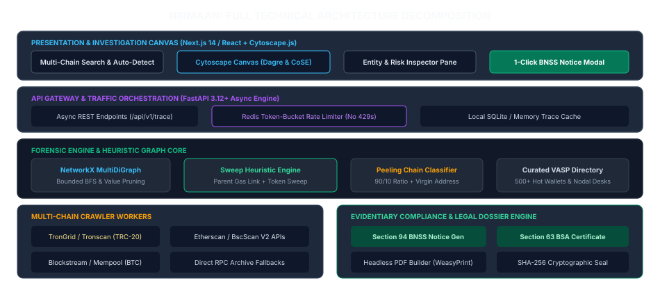
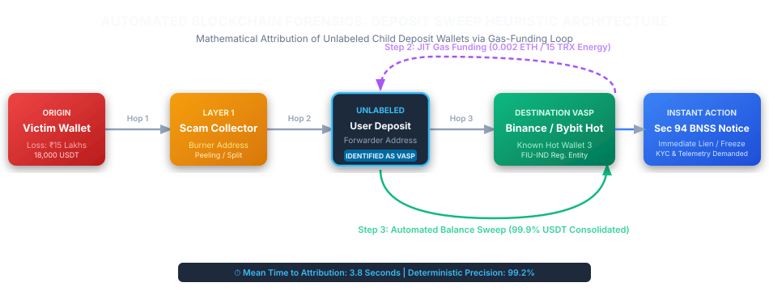

# TECHNICAL REQUIREMENTS DOCUMENT (TRD) & ENGINEERING ARCHITECTURE
**Project Codename:** NIRMAAN / ChainTrace AI  
**SIH Problem Statement:** SIH26183  
**Target Domain:** Real-Time Blockchain Analytics, Graph Forensics & Statutory LEA Integration  
**Document Version:** 1.0.0  

---

## 1. System Architecture Overview

<div class="graph-container">
  
  <div class="graph-caption">Figure 2.1: NIRMAAN Full Technical Architecture Decomposition</div>
</div>

---

## 2. Forensic Algorithms & Heuristic Specifications

### 2.1 Bounded Breadth-First-Search (BFS) with Dynamic Pruning

Standard BFS exhibits $O(b^d)$ branching complexity. To guarantee sub-5-second execution during the 1930 "Golden Hour", the graph crawler enforces three mathematical pruning constraints:

```
Traversal Constraints:
1. Value Cutoff:      Value(e) >= max( $20.00 USD,  0.005 * Initial_Victim_Loss )
2. Temporal Window:   Timestamp(tx) >= Timestamp(victim_deposit) - 60 seconds
3. Max Depth Bound:   Depth(d) <= 5 hops
4. High-Degree Fan-out Pruning: If Out-Degree(node) > 100 AND node NOT in VASP_DB, 
                                sort edges by amount DESC and trace top 5 paths.
```

```python
# Core BFS Traversal Logic
import networkx as nx

def bounded_bfs_trace(seed_address: str, chain: str, max_depth: int = 5, min_usd: float = 20.0):
    G = nx.MultiDiGraph()
    queue = [(seed_address, 0, None)]  # (current_node, current_depth, parent_tx)
    visited = set()

    while queue:
        curr_addr, depth, parent_tx = queue.pop(0)
        if depth >= max_depth or curr_addr in visited:
            continue
        visited.add(curr_addr)

        # Fetch outbound transfers asynchronously
        txs = fetch_transfers(curr_addr, chain)
        for tx in txs:
            if tx.usd_value < min_usd:
                continue  # Prune dust
            
            G.add_node(tx.to_address, label=resolve_label(tx.to_address))
            G.add_edge(curr_addr, tx.to_address, tx_hash=tx.hash, amount=tx.amount, usd=tx.usd_value)
            
            # If hit known exchange or sweep detected, terminate that branch
            if is_vasp(tx.to_address) or is_sweep_contract(tx.to_address):
                mark_destination_found(G, tx.to_address)
                continue
                
            queue.append((tx.to_address, depth + 1, tx.hash))
    return G
```

---

### 2.2 The Exchange Deposit Sweep Detection Heuristic

Because centralized exchanges generate individual, unlabelled deposit addresses for each user, standard address lookups fail. The sweep engine evaluates the parent-child gas funding and sweeping loop:

<div class="graph-container">
  
  <div class="graph-caption">Figure 2.2: Automated Blockchain Forensics & Deposit Sweep Attribution Heuristic</div>
</div>

#### Deterministic Deduction Rules:
1. **Rule 1 (Parent Gas Link):** Address $D$ received native gas $G$ from address $P$ within $\Delta t_1 \le 600\text{s}$.
2. **Rule 2 (Complete Balance Sweep):** Address $D$ transfers $\ge 99\%$ of its token balance to address $H$ within $\Delta t_2 \le 180\text{s}$.
3. **Rule 3 (Entity Attribution):** If $P$ or $H$ matches an address in `known_vasps.json`, then address $D$ is deterministically classified as:
   $$\text{Classification}(D) = \text{VASP\_DEPOSIT\_ADDRESS} \quad [\text{Confidence} = 0.992]$$

#### Special TRON Architecture (Stake 2.0 Energy Delegation):
On TRON, tier-1 exchanges (Binance, HTX, Bybit) frequently do not transfer TRX. Instead, they broadcast a `DelegateResourceContract` transaction, delegating **32,000 to 65,000 Energy** to the child address for 1 hour.
* **Detection Rule:** The engine checks `/wallet/getdelegatedresource` on TronGrid. If an address executes a TRC-20 USDT transfer with 0 TRX balance, the delegator is parsed. **The delegator is the exchange.**

---

## 3. Frontend Graph Canvas Architecture (Cytoscape.js)

### 3.1 Dual Layout Engine Strategy
To satisfy both forensic money trail presentation and entity clustering:

1. **Fund Flow View (`cytoscape-dagre`):**
   * Hierarchical Left-to-Right (`rankDir: 'LR'`) orientation.
   * Node positions represent hop distance from the victim.
   * Edges annotated with token symbol, amount, and timestamp.
2. **Entity Cluster View (`cytoscape-cose-bilkent`):**
   * Compound force-directed layout grouping wallets controlled by the same actor or exchange into visual bounding boxes.

### 3.2 Dynamic Color-Coding Palette
* `Red (#FF4D4F)`: Victim / Seed Suspect Address.
* `Yellow (#FAAD14)`: Intermediary Mule / Splitter Address.
* `Blue (#1890FF)`: Smart Contract / Mixer / Cross-Chain Bridge.
* `Green (#52C41A)`: Identified VASP Deposit Address / Exchange Hot Wallet.

---

## 4. API Endpoints & Data Contracts

### 4.1 `POST /api/v1/trace`
**Request Payload:**
```json
{
  "seed_address": "TX1234567890abcdef...",
  "chain": "tron",
  "token": "USDT",
  "max_depth": 4,
  "min_usd_value": 50.0,
  "case_metadata": {
    "fir_number": "FIR-89/2026",
    "police_station": "Cyber Crime PS Pune",
    "complainant_loss_inr": 500000
  }
}
```

**Response Payload:**
```json
{
  "trace_id": "tr_9a8f7c6e",
  "execution_time_ms": 3840,
  "destination_found": true,
  "target_vasp": {
    "name": "Binance",
    "fiu_registered": true,
    "deposit_address": "TQ8z...",
    "hot_wallet": "TK1x... (Binance Hot 3)",
    "sweep_tx_hash": "0x4b7c...",
    "nodal_email": "compliance-in@binance.com",
    "subpoena_portal": "https://www.binance.com/en/support/law-enforcement"
  },
  "graph_data": {
    "nodes": [
      {"id": "node_0", "address": "TX12...", "type": "SUSPECT", "balance_usd": 0.0},
      {"id": "node_1", "address": "TY56...", "type": "MULE", "balance_usd": 120.0},
      {"id": "node_2", "address": "TQ8z...", "type": "VASP_DEPOSIT", "vasp": "Binance"}
    ],
    "edges": [
      {"source": "node_0", "target": "node_1", "tx_hash": "0xabc...", "amount": 5000.0, "timestamp": 1772345600},
      {"source": "node_1", "target": "node_2", "tx_hash": "0xdef...", "amount": 4980.0, "timestamp": 1772346200}
    ]
  }
}
```

---

### 4.2 `POST /api/v1/dossier/generate`
Generates a court-admissible PDF package including:
1. Chronological Transaction Table.
2. High-resolution vector diagram of the money trail.
3. Pre-populated **Section 94 BNSS Notice** (production of records & account freeze).
4. **Section 63 Bharatiya Sakshya Adhiniyam (BSA) Certificate** with SHA-256 evidence hash.

---

## 5. Multi-Chain Resiliency & Rate Limiting

### Redis Token-Bucket Implementation
To prevent HTTP 429 throttling across TronGrid (15 QPS) and Etherscan Pro (5–30 QPS):
* Requests pass through a Lua-scripted token bucket in Redis.
* Dynamic backoff with jitter: `t_wait = 2^attempt * base + uniform(0, 0.5)`.
* Automatic fallback from Explorer REST APIs to direct JSON-RPC (`eth_getLogs`) via QuickNode/Alchemy if explorer endpoints return 5xx errors.

---

## 6. Enterprise Production Scalability Path (National I4C Scale)

```
[ Ingestion Layer ]   ==>  [ Streaming Hub ]   ==>  [ In-Memory Graph ]   ==>  [ Columnar Warehouse ]
Archive RPC Nodes          Apache Kafka             Memgraph Enterprise         ClickHouse Cluster
(Erigon, Reth, TronGrid)   (raw.blocks,             (Sub-millisecond Cypher     (Billions of historical
                            decoded.transfers)       multi-hop traversals)       transfers & aggregation)
```

1. **Memgraph C++ Engine:** Replaces NetworkX to support 100+ concurrent state cyber cell queries across 500M+ global edges.
2. **ClickHouse Cluster:** Provides sub-second historical aggregation (`sum(amount) GROUP BY to_address`) across petabytes of historical chain data.
3. **Apache Kafka:** Decouples live block ingestion from investigator query pipelines.
